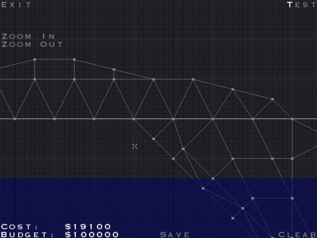
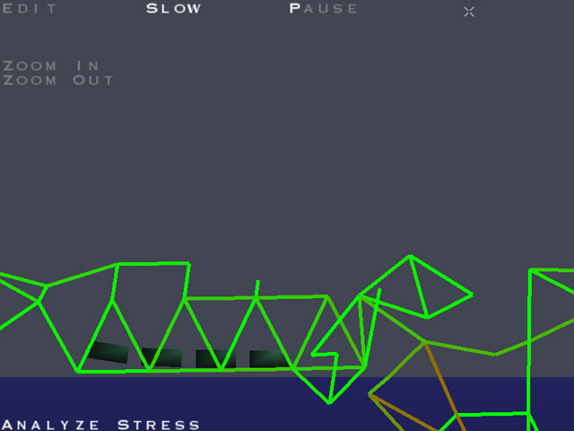

# Bridge Builder (2000) — WebAssembly & WebGL

[](https://s--i.github.io/BridgeBuilderDemo/)
[](tests/ui_test.mjs)

A faithful web reconstruction of Alex Austin's pioneering 2000 bridge-construction game **Bridge Builder** (originally distributed as `bbdemo.exe`).

Rebuilt from disassembly and decompilation with an **AssemblyScript / WebAssembly** discrete physics core, an authentic **WebGL** rendering pipeline, and the original 640×480 bitmap interface. Runs completely client-side in any modern browser with zero server dependencies or network assets.

👉 **[Play the game online](https://s--i.github.io/BridgeBuilderDemo/)**

---

<p align="center">
  
  
</p>

---

## Features & Fidelity

* **Bit-for-Bit Discrete Physics:** Reverse-engineered 30 Hz spring-mass solver with Euler integration, Hooke's law, elastic and breaking limits, gravity, damping, buoyancy, and authentic train wheel contact dynamics matching the original Watcom C++ executable.
* **Full 15-Level Campaign:** Includes all 15 official campaign levels (`level01.lvl` through `level15.lvl`) with authentic level unlocking progression and `localStorage` persistence.
* **Original Binary Compatibility:** Native import and export of original 2000 binary `.brg` bridge design files and `.lvl` level files.
* **Authentic 2000 Presentation:**
  * Fixed **640×480 logical resolution** with aspect-ratio-preserving 4:3 letterboxing.
  * Rendered using the original extracted bitmap font atlas (`Font.bmp`), including mnemonic shortcut letter highlighting and hover feedback.
  * Original polygon terrain shading, sunlight angle illumination, and animated wave lighting.
  * Authentic pure-red `(1, 0, 0)` cost and budget threshold warnings.
* **Faithful Edge Scrolling & Zoom:**
  * Screen-edge and letterbox overrun scrolling recreating the original fullscreen monitor-edge feel.
  * Authentic view half-width zoom increments ($320 / \text{halfW}$) with discrete tick-based click-and-hold repetition.
* **Zero Network Dependencies:** Standalone client-side code; opens directly via `file://` or static web hosting with no CORS, build server, or external CDN requirements.

---

## Controls

### Keyboard Shortcuts

| Screen | Key | Action |
|---|---|---|
| **Home** | <kbd>S</kbd> | Start Game (Level selection) |
| **Home** | <kbd>L</kbd> | Load Bridge (`.brg` file picker) |
| **Home** | <kbd>R</kbd> | View authentic Readme |
| **Editor** | <kbd>T</kbd> | Start testing bridge |
| **Simulation** | <kbd>T</kbd> | Dispatch train (Run Train) |
| **Simulation** | <kbd>S</kbd> | Toggle slow motion (0.25× speed) |
| **Simulation** | <kbd>P</kbd> | Toggle simulation pause |
| **Simulation** | <kbd>A</kbd> | Toggle stress analysis coloring |
| **Any** | <kbd>Z</kbd> / <kbd>Shift</kbd>+<kbd>Z</kbd> | Zoom in / Zoom out |
| **Any** | <kbd>Esc</kbd> | Cancel node selection / Return to previous screen |

### Mouse Controls

* **Left Click:** Select joint / place member between joints.
* **Right Click:** Delete member or node under cursor.
* **Middle Drag / Shift + Right Drag:** Pan camera view.
* **Mouse Wheel:** Smooth browser zoom convenience.
* **Screen Edge / Letterbox:** Push cursor to the screen edge or into the black letterbox bars to scroll the camera.
* **Zoom Buttons:** Click or click-and-hold **Zoom In** / **Zoom Out** on the HUD to continuously adjust zoom.

---

## Architecture

The project maintains a clean separation between authoritative simulation rules and browser presentation:

```
                      ┌────────────────────────────────────────┐
                      │          Browser DOM & Window          │
                      │  Screen flow, letterbox, input events  │
                      └───────────────────┬────────────────────┘
                                          │
            ┌─────────────────────────────┴─────────────────────────────┐
            ▼                                                           ▼
┌───────────────────────────────┐                       ┌───────────────────────────────┐
│     JavaScript & WebGL        │                       │     WebAssembly Module        │
│    (Presentation & Flow)      │                       │     (Game Logic & Rules)      │
├───────────────────────────────┤                       ├───────────────────────────────┤
│ • Screen state machine        │                       │ • Editor construction rules:  │
│   (Home, Levels, Readme, etc.)│                       │   - Joint picking & snapping  │
│ • Camera projection & pan/zoom│                       │   - 1.9–18.0m length limits   │
│ • 30 Hz/7.5 Hz timing loop    │◄──── sync / query ────┤   - Deck vs. iron selection   │
│ • WebGL terrain, water, train,│                       │   - Budget calculation        │
│   and bridge shaders          │                       │ • Physics simulation engine   │
│ • Bitmap font renderer        │                       │ • Win/loss condition checks   │
│ • Browser file I/O & storage  │                       │ • Binary .lvl & .brg parser   │
│ • Accessible overlay buttons  │                       │   and export serializer       │
└───────────────────────────────┘                       └───────────────────────────────┘
```

* **WebAssembly (`assembly/`):** Written in AssemblyScript and compiled to standalone Wasm. Owns joint snapping, 1.9–18.0 member length rules, cost/budget calculation, spring-mass physics, wheel traction, collapse detection, and binary serialization.
* **WebGL & Controls (`web/`):** Custom WebGL 1.0/2.0 render pipelines, viewport letterboxing, discrete-tick accumulator loops, keyboard dispatch, and base64 asset bundling for offline execution.

---

## Development & Building

### Prerequisites

* [Node.js](https://nodejs.org/) (v18 or newer recommended)

### Setup

```bash
git clone https://github.com/s--i/BridgeBuilderDemo.git
cd BridgeBuilderDemo
npm install
```

### Build

Compiles the AssemblyScript physics engine to WebAssembly and bundles font/level assets into standalone modules:

```bash
npm run build
```

### Run Tests

Runs the full 22-suite automated verification harness (testing bit-for-bit physics parity, memory bounds, shortcut dispatch, and camera fidelity):

```bash
npm test
```

### Play Locally

You can open `web/index.html` directly in any web browser without needing a local development server:

```bash
open web/index.html   # On macOS
# or double-click web/index.html in your file explorer
```

---

## Historical Context & Credits

* **Original Game:** *Bridge Builder* was originally created in **2000 by Alex Austin** and released freely as `bbdemo.exe`. It became a viral indie classic, spawning the subsequent *Pontifex* series, *Bridge Construction Set*, and an entire genre of physics construction games.
* **Preservation Purpose:** This repository is an educational reverse-engineering and digital preservation project to keep the original 2000 physics, level design, and aesthetics playable on modern platforms without requiring vintage Windows x86 virtual machines.
